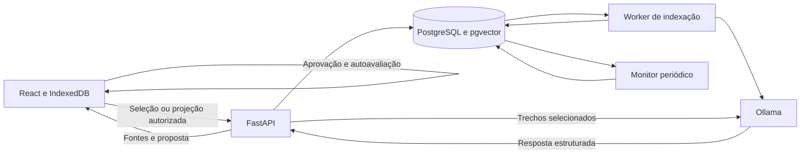

# Arquitetura da camada de inteligência

O React mantém a autoridade sobre cadastros e tentativas no dispositivo. A conexão com o monólito FastAPI é opcional. API, indexador e verificador periódico executam o mesmo pacote Python em processos com responsabilidades distintas. PostgreSQL coordena as transações, os trabalhos duráveis e os vetores. Ollama fornece embeddings e geração. O frontend fala com a API na mesma origem por meio do proxy do Vite no desenvolvimento.

Ao habilitar compartilhamento contínuo, a aba envia alterações com a revisão esperada. Gravações obsoletas recebem HTTP 409 e interrompem o envio automático. Reabrir a central e autorizar novo envio substitui explicitamente a projeção pela versão daquele dispositivo. A projeção não sincroniza dois dispositivos. O upload é independente dessa autorização. A biblioteca só entra no contexto de uma conversa pela seleção do estudante.

As migrações e consultas usam psycopg e SQL explícito para os operadores de pgvector, busca textual portuguesa e locks. O runner versionado usa uma transação e um bloqueio consultivo. A escolha mantém um caminho de instalação curto. A porta do provedor em rag.py pode receber um modelo específico de teste exclusivamente nos testes.

## Navegação e consulta direta

O menu Meu espaço inclui Monitor e Biblioteca. O perfil no canto superior direito concentra login, preferências e saída da conta. O Tutor abre o histórico e a conversa com o campo de mensagem visível. Para consultar fontes, basta selecionar materiais prontos e perguntar. Disciplina, conceito e objetivo deixam de ser pré-requisitos da conversa e do upload. O servidor continua exigindo proprietário autenticado e seleção explícita de documentos. As ações de reforço mantêm o conceito recebido na rota quando disponível.

O modo de estudo aceita uma disciplina e cria os vínculos de uma prática livre durante a mesma gravação de início quando o estudante omite objetivo e atividade. As etapas são botões. Praticar inicia o plano e Refletir encerra a medição antes de abrir o registro de resultados. A reflexão anterior ao início apresenta orientação para iniciar uma prática. Históricos existentes continuam acessíveis.
